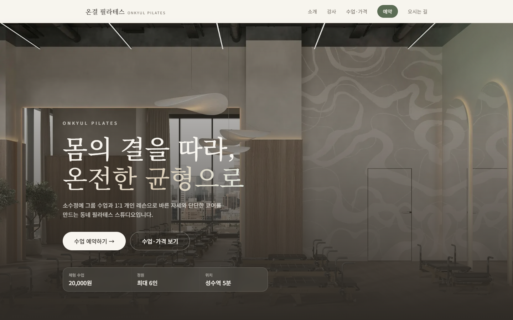
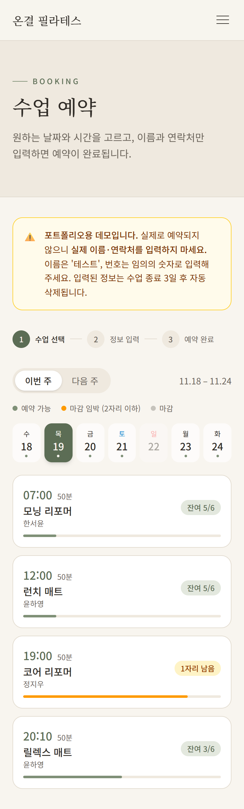
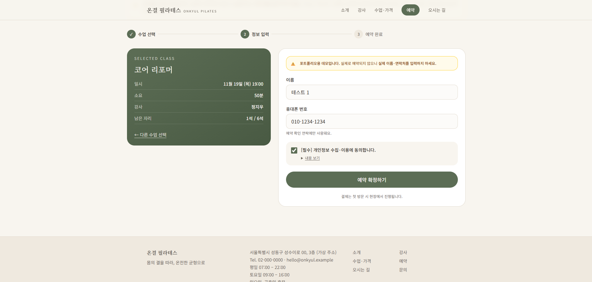
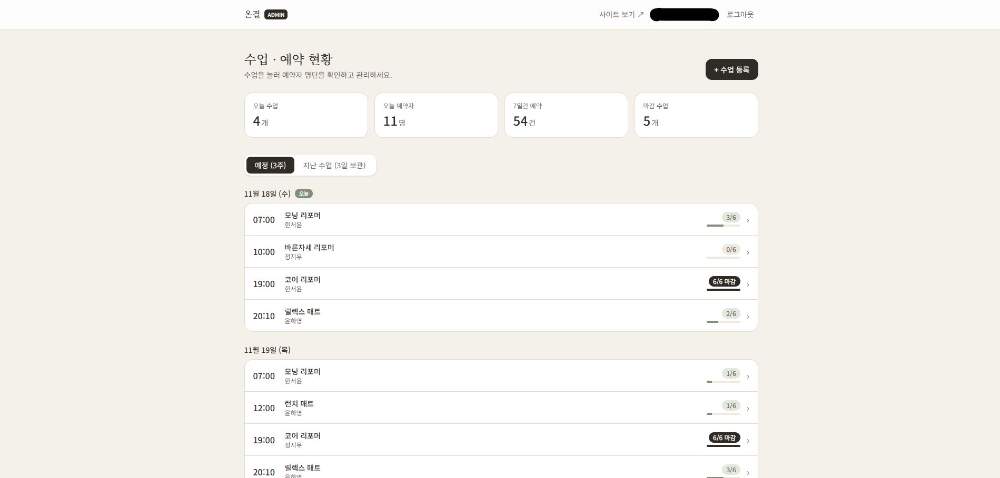

# 온결 필라테스 — 스튜디오 홈페이지 + 실시간 수업 예약 시스템

> 소규모 필라테스·요가·PT 스튜디오용 **브랜드 홈페이지 + 온라인 예약 + 관리자 페이지** 견본 프로젝트입니다.
> ※ 포트폴리오용 가상 매장으로, 매장명·주소·연락처·후기는 모두 예시입니다.

**🔗 데모:** https://onkyul-pilates.vercel.app  ·  예약: [/booking](https://onkyul-pilates.vercel.app/booking)

<!-- 스크린샷: docs/screenshots/ 폴더에 넣고 아래 경로를 맞춰 주세요 -->
| 메인 (PC) | 예약 시간표 (모바일) | 예약 완료 | 관리자 명단 |
|---|---|---|---|
|  |  |  |  |

---

## 이런 분께 맞는 구성입니다

- 전화·DM으로 예약을 받느라 수업 중에도 휴대폰을 봐야 하는 스튜디오
- 회원이 **남은 자리를 직접 보고** 예약하길 원하는 곳
- 별도 앱 없이 **홈페이지 하나로** 소개·가격·예약·관리를 끝내고 싶은 곳

## 주요 기능

### 회원(방문자)
- **브랜드 홈페이지**: 메인, 스튜디오 소개, 강사 소개, 수업·가격표, 오시는 길(지도), 문의·FAQ
- **실시간 예약**: 주간 시간표 → 수업 선택 → 이름·연락처 입력 → 예약 완료
  - 남은 자리 실시간 표시, **마감 임박(2자리 이하)** 강조, 정원 차면 자동 **'마감'**
  - 회원가입 없이 1분 예약, 휴대폰 번호 자동 하이픈
  - 개인정보 수집·이용 동의(필수) + 동의 시각 기록
  - 완료 화면에서 예약번호 발급, **내 캘린더(.ics)에 추가**
- **모바일 최적화**: 375px 기준 설계, 하단 고정 '전화·위치·예약' 바

### 운영자(/admin)
- 이메일 로그인 (관리자로 등록된 계정만 접근)
- 대시보드: 오늘 수업·예약자 수, 7일간 예약, 마감 수업 통계
- 수업별 **예약자 명단**, 전화 바로 걸기, 명단 복사, **예약 취소**(자리 자동 반환)
- 수업 **등록·수정·취소/복구** (예약 인원보다 정원을 줄이지 못하게 방지)

## 기술 스택

| 영역 | 사용 기술 |
|---|---|
| 프레임워크 | Next.js 16 (App Router, Server Actions, Cache Components/PPR), React 19, TypeScript(strict) |
| 스타일 | Tailwind CSS v4, next/font (Noto Sans/Serif KR), CSS 애니메이션 |
| 백엔드 | Supabase — Postgres, Auth, Row Level Security, RPC(plpgsql) |
| 배포 | Vercel |
| SEO | 페이지별 메타 태그, 동적 OG 이미지, sitemap.xml, robots.txt, JSON-LD |

추가 UI 라이브러리 없이 구현해 번들이 가볍고 유지보수가 쉽습니다.

## 보안 설계

예약 시스템에서 가장 중요한 두 가지, **정원 초과 방지**와 **예약자 개인정보 보호**를 DB 레벨에서 보장했습니다.

### 1. 정원 관리: RPC 한 곳에서, 트랜잭션으로

```
[예약 버튼] → Server Action (입력 검증) → create_booking() RPC
                                           ├─ 입력 재검증 · 동의 확인
                                           ├─ 연락처당 예약 수 제한 (도배 방지)
                                           ├─ SELECT … FOR UPDATE  ← 수업 행 잠금
                                           ├─ 확정 예약 수 < 정원 ? 
                                           └─ INSERT (같은 트랜잭션)
```

- 예약은 **`create_booking()` 함수로만** 생성됩니다. `bookings` 테이블에는 insert 정책이 없어 직접 삽입이 불가능합니다.
- 함수 안에서 수업 행을 `FOR UPDATE`로 잠그기 때문에, **동시에 여러 명이 마지막 자리를 눌러도** 한 명씩 처리되어 정원을 절대 넘지 않습니다.
- 같은 수업에 같은 연락처로 중복 예약은 **부분 unique 인덱스**로 차단합니다.

### 2. 개인정보 보호: Row Level Security

| 테이블 | 비로그인 | 관리자 |
|---|---|---|
| `class_sessions` | 조회만 | 등록·수정·삭제 |
| `bookings` | **접근 불가** (테이블 권한 자체 회수) | 조회, 취소 처리 |
| `admins` | 접근 불가 | 본인 행만 조회 |

- 남은 자리는 `get_session_availability()` 함수가 **숫자만** 반환합니다. 이름·연락처는 절대 공개 API로 나가지 않습니다.
- API로는 예약을 삭제할 수 없고 `cancelled` 상태로만 바꿀 수 있습니다. 보관 기간(수업 종료 후 3일)이 지난 수업과 예약은 **DB 스케줄러가 자동 파기**합니다(개인정보 최소 보관).
- 관리자 추가는 API로 불가능하며 DB에서만 가능합니다(권한 상승 차단).

### 3. 관리자 권한: 서버에서 매번 확인

- `/admin`의 모든 페이지와 **모든 서버 액션**이 `supabase.auth.getUser()`(토큰 서버 검증) + `admins` 테이블 확인을 거칩니다. 클라이언트 체크에 의존하지 않습니다.
- 브라우저에는 공개용 anon 키만 전달되며, service role 키는 사용하지 않습니다.
- 입력값은 **서버 액션 + DB 함수 + 테이블 제약조건** 3단계로 검증합니다.
- 보안 헤더(X-Frame-Options, nosniff 등), 봇 방지 숨김 필드, 관리자 페이지 검색 노출 차단(noindex, robots).

### 4. 데모 운영: 시간표 자동 유지

포트폴리오 데모가 언제 접속해도 살아 있도록, 오늘 기준 **이번 주·다음 주 시간표가 항상 채워집니다.**

| 장치 | 역할 |
|---|---|
| `pg_cron` (매일 03:00 KST) | `run_demo_maintenance()` 실행: 지난 데이터 파기 → 비어 있는 날짜의 수업 생성 |
| 조회 시점 안전장치 | 시간표를 열 때 `ensure_demo_sessions()` 호출. 14일치가 이미 있으면 즉시 종료하고, cron이 빠진 날에만 생성 |
| `demo_generated_days` | 생성한 날짜를 기록해, 관리자가 옮기거나 취소한 수업을 다시 만들지 않음 |

새로 생성되는 날마다 데모 예약 몇 건을 함께 넣어 '마감'·'마감 임박' 표시가 항상 보이게 했습니다. 예약 화면에는 "실제 정보를 입력하지 마세요" 안내가 있습니다.

## 프로젝트 구조

```
src/
├─ app/
│  ├─ (site)/            # 공개 페이지 (공통 헤더·푸터·모바일 하단 바)
│  │  ├─ booking/        # 예약: 시간표·폼·완료 (BookingFlow), 서버 액션
│  │  └─ about, instructors, classes, location, contact
│  ├─ admin/             # 관리자: 로그인, 대시보드, 수업 상세·등록, 서버 액션
│  ├─ opengraph-image.tsx, sitemap.ts, robots.ts
├─ components/           # 공통 UI (Section, PageHeader, 카드, 가격표 등)
├─ data/                 # 매장·강사·수업·가격 상수 → 문구 수정은 여기만
├─ lib/                  # Supabase 클라이언트, 관리자 확인, 검증, 날짜(서울 시간)
└─ proxy.ts              # /admin 세션 토큰 갱신
supabase/
├─ migrations/           # ① 테이블·RLS·RPC  ② 데모 시간표 자동 유지·자동 파기(pg_cron)
└─ seed.sql              # 수동으로 일정 다시 채우기
```

## 로컬 실행

```bash
npm install
cp .env.example .env.local   # Supabase URL / anon key 입력
npm run dev
```

1. Supabase SQL Editor에서 `supabase/migrations/` 의 파일 두 개를 **이름 순서대로** 실행 (두 번째 파일이 14일치 수업을 바로 채움)
2. Authentication → Users에서 관리자 계정 생성 후, SQL Editor에서 등록
   ```sql
   insert into public.admins (user_id)
   select id from auth.users where email = '관리자 이메일';
   ```
3. Authentication → Sign In / Providers에서 **신규 가입(Allow new users to sign up) 끄기** 권장

## 커스터마이징

- 매장명·주소·가격·강사·FAQ: `src/data/*.ts` 수정
- 색상: `src/app/globals.css`의 `@theme` 토큰
- 사진: `public/images` 교체 후 `src/data/images.ts` 수정

## 이미지 출처

모든 사진은 [Unsplash License](https://unsplash.com/license)(무료 상업적 사용 가능)를 따릅니다.

| 파일 | 작가 | 원본 |
|---|---|---|
| hero-studio.jpg | Maverick Frame | https://unsplash.com/photos/GQuXJnv4t60 |
| reformer-1.jpg | ROXANA POPOVICI | https://unsplash.com/photos/aY5uOJ2o96g |
| reformer-2.jpg | ROXANA POPOVICI | https://unsplash.com/photos/5JQxj-zc5ng |
| reformer-3.jpg | ROXANA POPOVICI | https://unsplash.com/photos/cZ0WYsBFHhs |
| equipment.jpg | Caroline Badran | https://unsplash.com/photos/m56-PAdMhM0 |
| mat.jpg | Nasim Keshmiri | https://unsplash.com/photos/twBW7obiOLQ |

강사는 가상 인물이므로 실존 인물 사진 대신 모노그램 디자인을 사용했습니다.

## 향후 확장 아이디어

- 예약 확정 알림톡/SMS (카카오 비즈메시지 등)
- 회원 로그인·수강권 차감, 대기 예약
- 결제(토스페이먼츠) 연동
